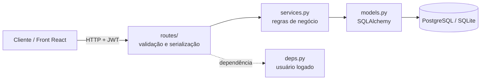
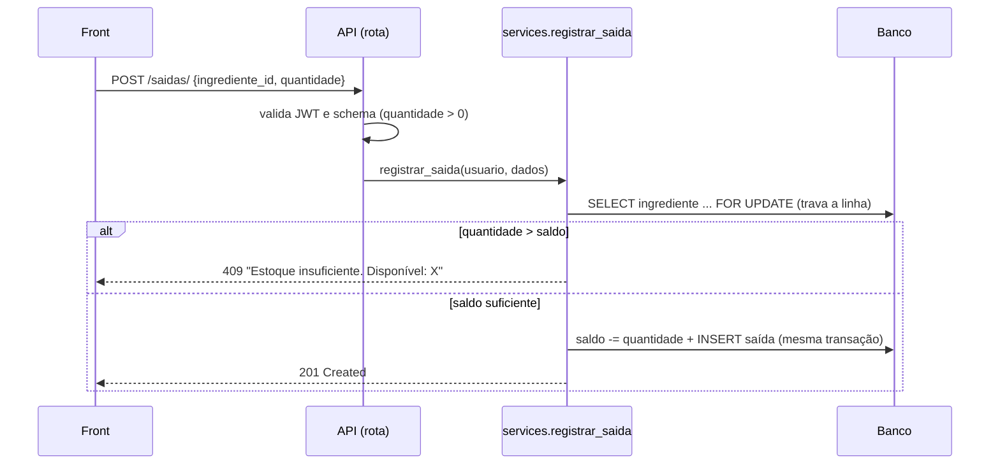
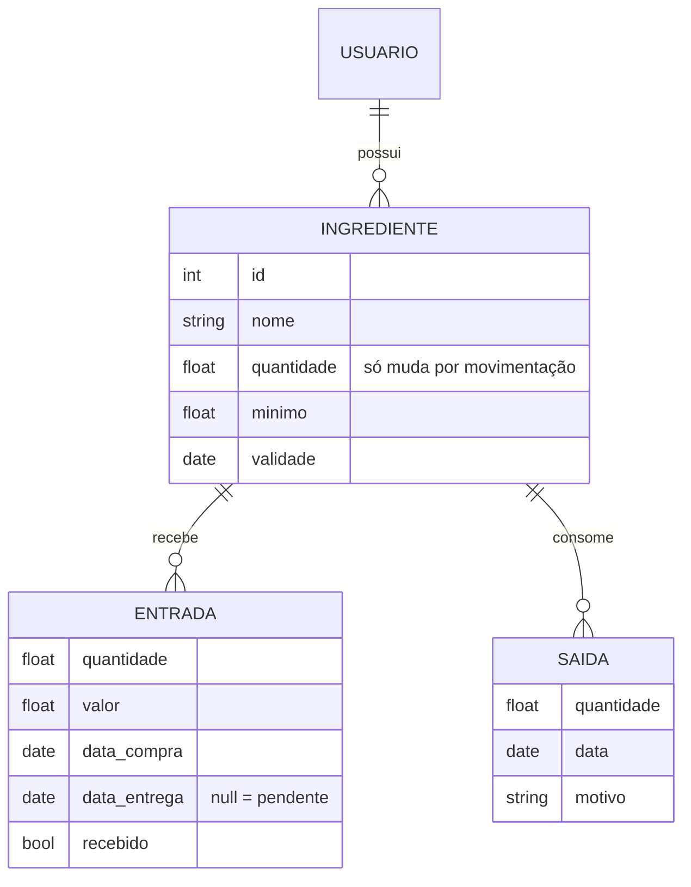

# 🧁 EstoqueChef — API

API de controle de estoque para restaurantes e confeitarias, construída com **Python, FastAPI e SQLAlchemy 2**.
Cadastro de ingredientes, **entradas** (compras, inclusive pedidos ainda pendentes) e **saídas** (uso, venda, perda),
com autenticação JWT e regras de saldo garantidas no servidor.

> 🖥️ Interface: repositório **estoquechef-frontend** (React + Vite), que consome esta API.

## O que este projeto demonstra

| Competência | Onde ver |
|---|---|
| Modelagem de domínio (estoque como livro-caixa) | [`services.py`](estoquechef/services.py) |
| API REST com FastAPI, validação com Pydantic v2 | [`schemas.py`](estoquechef/schemas.py), [`routes/`](estoquechef/routes) |
| Autenticação OAuth2 + JWT (access e refresh) | [`security.py`](estoquechef/security.py), [`routes/auth.py`](estoquechef/routes/auth.py) |
| Consistência e concorrência (`SELECT ... FOR UPDATE`) | `buscar_ingrediente(..., travar=True)` |
| Isolamento de dados entre usuários | toda consulta filtra por `usuario_id` |
| Testes automatizados (17) | [`tests/`](tests) |
| Containerização (Docker + Postgres) | [`Dockerfile`](Dockerfile), [`docker-compose.yml`](docker-compose.yml) |
| Configuração por ambiente, CLI própria | [`config.py`](estoquechef/config.py), [`cli.py`](estoquechef/cli.py) |

## Como funciona

### A ideia central: o saldo nunca é editado direto

Um ingrediente tem uma `quantidade` em estoque, mas **ninguém a altera diretamente**. Ela é sempre a
consequência de uma movimentação, como num livro-caixa. Assim, todo número tem origem rastreável.

| Ação | Efeito no saldo |
|---|---|
| Entrada **recebida** | soma |
| Entrada **pendente** (pedido que ainda não chegou) | nenhum, até ser marcada como recebida |
| Saída | subtrai; responde **409** se o saldo não bastar |
| Excluir saída | devolve a quantidade ao estoque |
| Excluir entrada recebida | subtrai de volta; **409** se parte dela já foi consumida |
| Editar ingrediente (`PUT`) | **não** aceita `quantidade` (o campo nem existe no schema) |

### Arquitetura em camadas



As **rotas** só validam entrada e serializam saída. Toda regra de negócio está em `services.py`, o que a
deixa testável sem HTTP e impede que uma rota "esqueça" de validar o saldo.

### O que acontece ao registrar uma saída



### Modelo de dados



## Passo a passo para rodar

### Opção A — Docker (API + Postgres)

Pré-requisito: Docker.

```bash
git clone <url-deste-repositorio> && cd estoquechef-backend
docker compose up --build            # sobe Postgres e a API
docker compose exec api estoquechef seed   # cria o usuário demo / demo123 com dados de exemplo
```

API em http://localhost:8000 · documentação interativa (Swagger) em http://localhost:8000/docs

### Opção B — Local, sem Docker (SQLite)

Pré-requisito: Python ≥ 3.10.6.

```bash
python -m venv .venv && source .venv/bin/activate      # Windows: .venv\Scripts\activate
pip install -r requirements-dev.txt -e .
cp .env.example .env
estoquechef seed                     # opcional: usuário demo / demo123 + dados de exemplo
estoquechef run --reload             # http://localhost:8000
```

### Testando a API com curl (tour de 2 minutos)

```bash
# 1. cadastrar e fazer login (o login é OAuth2: formulário, não JSON)
curl -X POST localhost:8000/user/ -H "Content-Type: application/json" \
  -d '{"username":"ana","email":"ana@x.com","password":"123456"}'
TOKEN=$(curl -s -X POST localhost:8000/token -d "username=ana&password=123456" \
  | python -c "import sys,json; print(json.load(sys.stdin)['access_token'])")
AUTH="Authorization: Bearer $TOKEN"; JSON="Content-Type: application/json"

# 2. criar um ingrediente com 3 kg de saldo inicial
curl -X POST localhost:8000/ingredientes/ -H "$AUTH" -H "$JSON" \
  -d '{"nome":"Farinha","categoria":"Secos","unidade":"kg","minimo":5,"quantidade":3}'

# 3. registrar uma compra PENDENTE (data_entrega nula): o saldo continua 3
curl -X POST localhost:8000/entradas/ -H "$AUTH" -H "$JSON" \
  -d '{"ingrediente_id":1,"quantidade":10,"valor":68,"data_compra":"2026-11-02","data_entrega":null}'

# 4. marcar como recebida: o saldo vira 13
curl -X POST localhost:8000/entradas/1/receber -H "$AUTH"

# 5. tentar retirar mais do que existe: 409 Conflict
curl -X POST localhost:8000/saidas/ -H "$AUTH" -H "$JSON" \
  -d '{"ingrediente_id":1,"quantidade":99,"data":"2026-11-02","motivo":"Uso na produção"}'
# {"detail":"Estoque insuficiente. Disponível: 13 kg."}
```

### Rodando os testes

```bash
pytest          # 17 testes, usam SQLite em memória, sem precisar de banco externo
```

Cobrem: cadastro/login/refresh, rotas protegidas, saldo em cada tipo de movimentação, 409 em saída sem saldo,
bloqueio de exclusão de entrada já consumida, isolamento entre usuários, validações e erro de arredondamento de `float`.

## Endpoints

| Método e rota | O que faz |
|---|---|
| `POST /user/` · `POST /token` · `POST /refresh_token` · `GET /user/{username}/` | cadastro, login, renovação do token, perfil |
| `GET` `POST /ingredientes/` | lista / cria (com saldo inicial) |
| `PUT` `DELETE /ingredientes/{id}` | edita (sem `quantidade`) / exclui junto com o histórico |
| `GET` `POST /entradas/` | lista / registra compra (`data_entrega: null` = pendente) |
| `POST /entradas/{id}/receber` · `DELETE /entradas/{id}` | recebe e soma / desfaz (409 se já consumida) |
| `GET` `POST /saidas/` · `DELETE /saidas/{id}` | lista / registra (409 sem saldo) / desfaz e devolve |
| `GET /health` | verificação de vida da API |

Todas, exceto cadastro, login, refresh e health, exigem `Authorization: Bearer <access_token>`.

## Estrutura

```
estoquechef/
  app.py          # aplicação FastAPI, CORS, rotas
  config.py       # configurações via variáveis de ambiente (pydantic-settings)
  db.py           # engine e sessão por requisição
  models.py       # tabelas (SQLAlchemy 2)
  schemas.py      # contratos de entrada e saída (Pydantic v2)
  security.py     # bcrypt e JWT (access/refresh)
  deps.py         # dependência "usuário logado"
  services.py     # regras de negócio do estoque
  routes/         # auth, ingredientes, entradas, saidas
  cli.py          # comando `estoquechef` (run, seed)
tests/            # pytest
```

## Configuração

| Variável | Padrão | Para quê |
|---|---|---|
| `DATABASE_URL` | `sqlite:///./estoquechef.db` | `postgresql+psycopg2://...` em produção |
| `SECRET_KEY` | valor de desenvolvimento | **troque** em produção (≥ 32 bytes) |
| `ACCESS_TOKEN_MINUTES` / `REFRESH_TOKEN_DAYS` | 30 / 7 | validade dos tokens |
| `CORS_ORIGINS` | `http://localhost:5173` | origens do front, separadas por vírgula |

## Decisões técnicas (para conversar em entrevista)

- **Regras em `services.py`, não nas rotas.** Testável sem HTTP e sem risco de uma rota pular a validação.
- **404, e não 403, para recurso de outro usuário.** Não confirma que o recurso existe.
- **`FOR UPDATE` nas escritas de saldo.** Duas saídas simultâneas não leem o mesmo saldo e ultrapassam o estoque (efeito no Postgres; o SQLite ignora).
- **Refresh token com claim `type`.** Um access token não pode ser usado como refresh, nem o contrário.
- **Saldo arredondado a 3 casas.** Evita `0.1 + 0.1 + 0.1 = 0.30000000000000004` (há teste para isso).
- **Mesma imagem, bancos diferentes.** SQLite local e Postgres em produção só mudando `DATABASE_URL`.

## Limitações e próximos passos

- Tabelas criadas com `create_all`: o passo seguinte é **migrações com Alembic**.
- `float` para quantidades; para valores monetários, `Numeric/Decimal` seria mais rigoroso.
- Excluir um ingrediente apaga o histórico (cascade); uma alternativa seria arquivar.
- Listas sem paginação.
- Mensagens de validação 422 do Pydantic saem em inglês.
- Sem rate limiting no login.
